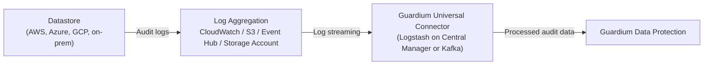

# Guardium Datastore Audit Configuration Terraform Module

Terraform modules that configure audit logging on cloud and on-premises datastores and integrate them with IBM Guardium Data Protection (GDP) through a Universal Connector (UC).

## Legacy: Logstash on Central Manager

These examples use the **legacy Logstash-based Universal Connector on the Guardium Central Manager**.

| Datastore | Terraform Module | Audit Method | Log Destination |
|-----------|------------------|--------------|-----------------|
| AWS DynamoDB | [aws-dynamodb](examples/aws-dynamodb) | CloudTrail Data Events | CloudWatch Logs |
| AWS DocumentDB | [aws-documentdb](examples/aws-documentdb) | DocumentDB Audit Logs | CloudWatch Logs |
| AWS MariaDB RDS | [aws-mariadb-rds-audit](examples/aws-mariadb-rds-audit) | MariaDB Audit Plugin | CloudWatch Logs |
| AWS MySQL RDS | [aws-mysql-rds-audit](examples/aws-mysql-rds-audit) | MariaDB Audit Plugin | CloudWatch Logs |
| AWS Aurora MySQL | [aws-aurora-mysql-audit](examples/aws-aurora-mysql-audit) | MariaDB Audit Plugin | CloudWatch Logs |
| AWS Neptune | [aws-neptune-audit](examples/aws-neptune-audit) | Neptune Audit Logs | CloudWatch Logs |
| AWS OpenSearch | [amazon-opensearch-audit](examples/amazon-opensearch-audit) | OpenSearch Audit Logs | CloudWatch Logs |
| AWS PostgreSQL RDS (Object) | [aws-postgresql-rds-object](examples/aws-postgresql-rds-object), [aws-postgresql-rds-object-tables](examples/aws-postgresql-rds-object-tables) | pgAudit (Object-Level) | CloudWatch Logs / SQS |
| AWS PostgreSQL RDS (Session) | [aws-postgresql-rds-session](examples/aws-postgresql-rds-session) | pgAudit (Session-Level) | CloudWatch Logs / SQS |
| AWS Aurora PostgreSQL (Object) | [aws-aurora-postgres-object](examples/aws-aurora-postgres-object) | pgAudit (Object-Level) | CloudWatch Logs / SQS |
| AWS Aurora PostgreSQL (Session) | [aws-aurora-postgres-session](examples/aws-aurora-postgres-session) | pgAudit (Session-Level) | CloudWatch Logs / SQS |
| AWS Redshift | [aws-redshift-with-uc](examples/aws-redshift-with-uc) | Connection & User Activity Logs | CloudWatch Logs / S3 |
| AWS S3 | [aws-s3-audit](examples/aws-s3-audit) | CloudTrail | CloudWatch Logs |
| Azure Cosmos DB | [azure-cosmos-audit](examples/azure-cosmos-audit) | Diagnostic Settings | Azure Event Hub |
| Azure MySQL Flexible Server | [azure-mysql-audit](examples/azure-mysql-audit) | Diagnostic Settings | Azure Event Hub |
| Azure PostgreSQL Flexible Server | [azure-postgres-audit](examples/azure-postgres-audit) | Diagnostic Settings + pgAudit | Azure Event Hub |
| Azure SQL Database | [azure-sql-audit](examples/azure-sql-audit) | Server & Database Auditing | Azure Storage Account (JDBC) |
| Azure Databricks (UC 1.0) | [databricks-audit](examples/databricks-audit) | Diagnostic Settings | Azure Event Hub |
| GCP AlloyDB | [gcp-alloydb-audit](examples/gcp-alloydb-audit) | AlloyDB PostgreSQL Logs | Audit transport resources |
| On-prem MySQL | [onprem-mysql](examples/onprem-mysql) | MySQL Audit Plugin | Syslog |
| On-prem Cassandra | [onprem-cassandra](examples/onprem-cassandra) | Cassandra Audit Logs | Filebeat |
| On-prem Couchbase | [onprem-couchbase](examples/onprem-couchbase) | Couchbase Audit Logs | Filebeat |
| Couchbase Capella | [couchbase-capella](examples/couchbase-capella) | Capella Audit Logs | REST API |

## Kafka-Based Universal Connector

| Datastore | Terraform Module | Audit Method | Log Destination |
|-----------|------------------|--------------|-----------------|
| AWS OpenSearch | [amazon-opensearch-audit-kafka](examples/amazon-opensearch-audit-kafka) | OpenSearch Audit Logs | CloudWatch Logs |
| Azure Databricks | [databricks-audit-kafka](examples/databricks-audit-kafka) | Diagnostic Settings | Azure Event Hub |

## Architecture



### Architecture Flow

1. **Datastore Configuration**: The module configures each datastore to enable audit logging:

   **AWS Datastores:**
   - **DynamoDB**: Enables CloudTrail data events to capture API calls
   - **DocumentDB**: Enables audit and profiler logs via parameter groups
   - **MariaDB RDS**: Enables MariaDB Audit Plugin via option groups
   - **MySQL RDS**: Enables MariaDB Audit Plugin via option groups (compatible with MySQL)
   - **Neptune**: Enables audit logs via parameter groups
   - **PostgreSQL RDS**: Configures pgAudit extension for object or session-level auditing
   - **Aurora PostgreSQL**: Configures pgAudit extension for object or session-level auditing with cluster parameter groups
   - **Redshift**: Enables connection and user activity logging to CloudWatch or S3

   **Azure Datastores:**
   - **Cosmos DB**: Enables diagnostic settings to capture data plane, query runtime, and control plane logs
   - **MySQL Flexible Server**: Enables diagnostic settings to stream audit logs to Azure Event Hub
   - **PostgreSQL Flexible Server**: Enables diagnostic settings to stream pgAudit logs to Azure Event Hub
   - **SQL Database**: Enables server-level and database-level auditing to Azure Storage Account

   **Cloud-Native Datastores:**
   - **Couchbase Capella**: Enables audit logging via Capella API for cloud-native deployments

2. **Log Aggregation**: Audit logs are collected in cloud platforms:

   **AWS:**
   - CloudWatch Log Groups store structured logs
   - S3 buckets provide long-term storage for CloudTrail logs
   - IAM roles and policies ensure secure access

   **Azure:**
   - Event Hub receives real-time diagnostic logs
   - Storage accounts provide checkpointing for Event Hub consumers
   - Azure RBAC ensures secure access

3. **Universal Connector**: The module deploys and configures Guardium Universal Connector:
   - Establishes connection to CloudWatch Logs, S3, or Azure Event Hub
   - Uses AWS or Azure credentials configured in Guardium
   - Applies parsing rules specific to each datastore type
   - Streams processed data to Guardium Data Protection

4. **Guardium Integration**: Audit data flows into Guardium for:
   - Real-time security monitoring
   - Compliance reporting (PCI-DSS, HIPAA, GDPR, etc.)
   - Threat detection and alerting
   - Forensic analysis and investigation

## Prerequisites

Before using these examples, ensure you have:

1. **Cloud Account**: With appropriate permissions to create and manage resources:

   **For AWS:**
   - CloudTrail and CloudWatch resources
   - IAM roles and policies
   - S3 buckets
   - Database parameter/option groups
   - SQS queues (for PostgreSQL modules)

   **For Azure:**
   - Diagnostic settings
   - Event Hub namespaces and Event Hubs
   - Storage accounts
   - Azure RBAC permissions

2. **Guardium Data Protection Instance**: A running GDP cluster (version 12.2.1 or above) with:
   - Web UI credentials with appropriate permissions
   - OAuth client registered via `grdapi register_oauth_client`
   - AWS credentials configured in Universal Connector (for AWS datastores)
   - Azure credentials configured in Universal Connector (for Azure datastores)

3. **Terraform**: Version 1.0.0 or later

4. **Cloud CLI**: Configured with appropriate credentials
   - **AWS CLI** for AWS datastores
   - **Azure CLI** for Azure datastores

## Guardium Data Protection Version Compatibility

**Supported Versions:** This module requires IBM Guardium Data Protection (GDP) version **12.2.1 and above**.

All modules that register datastores with Guardium Universal Connector use API-based upload for Universal Connector profile deployment, which provides secure and reliable integration with Guardium Data Protection.

See the README and `terraform.tfvars.example` in each example directory for variables and usage.

## Key Features

- **Automated Configuration**: Automatically configures audit logging for AWS and Azure datastores and Couchbase Capella
- **Universal Connector Integration**: Seamlessly integrates with Guardium Universal Connector
- **Multiple Datastore Support**: Supports DynamoDB, DocumentDB, MariaDB RDS, MySQL RDS, Aurora MySQL, Neptune, OpenSearch, PostgreSQL RDS, RedShift, Aurora PostgreSQL, Azure Cosmos, Azure MySQL, and Azure PostgreSQL
- **Flexible Audit Levels**: Choose between object-level and session-level auditing for PostgreSQL and Aurora PostgreSQL
- **CloudWatch Integration**: Leverages CloudWatch Logs for centralized log management
- **Aurora Cluster Support**: Native support for Aurora MySQL and Aurora PostgreSQL clusters with automatic parameter group management
- **Cloud-Native Support**: Includes support for Couchbase Capella cloud-native database platform and Azure Cosmos DB
- **Compliance Ready**: Supports compliance requirements (PCI-DSS, HIPAA, GDPR, SOC 2)
- **Terraform Native**: Fully declarative infrastructure as code approach

## Security Considerations

- **Credentials Management**: Store sensitive credentials securely using Terraform variables or secret management solutions
- **State File Security**: Ensure Terraform state files are encrypted and stored securely
- **IAM Permissions**: Follow the principle of least privilege for all IAM roles and policies
- **Network Security**: Configure security groups and network ACLs appropriately
- **Encryption**: Enable encryption for CloudWatch Logs, S3 buckets, and data in transit
- **Access Control**: Implement proper access controls for Guardium and AWS/Azure resources

## Troubleshooting

### Common Issues

1. **CloudTrail Not Capturing Events**:
- Verify CloudTrail is configured with data events for the specific datastore
- Check IAM permissions for CloudTrail
- Ensure CloudWatch Log Group is properly configured

2. **Universal Connector Not Processing Logs**:
- Verify AWS/Azure credentials are correctly configured in Guardium
- Check network connectivity between Guardium and cloud providers
- Review Universal Connector logs in Guardium UI

3. **Parameter/Option Group Changes Not Applied**:
- Some changes require database restart or failover
- Check the `force_failover` variable setting
- Review AWS RDS events for any errors

4. **Authentication Errors**:
- Verify Guardium OAuth client credentials
- Check Guardium user has appropriate permissions
- Ensure OAuth client is properly registered via `grdapi register_oauth_client`

For detailed troubleshooting, refer to the individual example READMEs.

## Contributing

Contributions are welcome! Please read [CONTRIBUTING.md](CONTRIBUTING.md) for details on our code of conduct and the process for submitting pull requests.

## Support

For issues and questions:
- Create an issue in this repository
- Contact the maintainers listed in [MAINTAINERS.md](MAINTAINERS.md)

## License

This project is licensed under the Apache 2.0 License - see the [LICENSE](LICENSE) file for details.

```text
#
# Copyright IBM Corp. 2025
# SPDX-License-Identifier: Apache-2.0
#
```

## Authors

Module is maintained by IBM with help from [these awesome contributors](https://github.com/IBM/terraform-guardium-datastore-va/graphs/contributors).

## Additional Resources

- [IBM Guardium Data Protection Documentation](https://www.ibm.com/docs/en/guardium)
- [Guardium Universal Connector Guide](https://www.ibm.com/docs/en/guardium/12.2?topic=connectors-universal-connector)
- [AWS CloudTrail Documentation](https://docs.aws.amazon.com/cloudtrail/)
- [AWS CloudWatch Logs Documentation](https://docs.aws.amazon.com/cloudwatch/latest/logs/)
- [Terraform AWS Provider Documentation](https://registry.terraform.io/providers/hashicorp/aws/latest/docs)
- [Azure Monitor Documentation](https://docs.microsoft.com/azure/azure-monitor/)
- [Azure Event Hubs Documentation](https://docs.microsoft.com/azure/event-hubs/)
- [Couchbase Capella Documentation](https://docs.couchbase.com/cloud/)
